# ⚡Minima More — Same blockchain. A fraction of the resources.

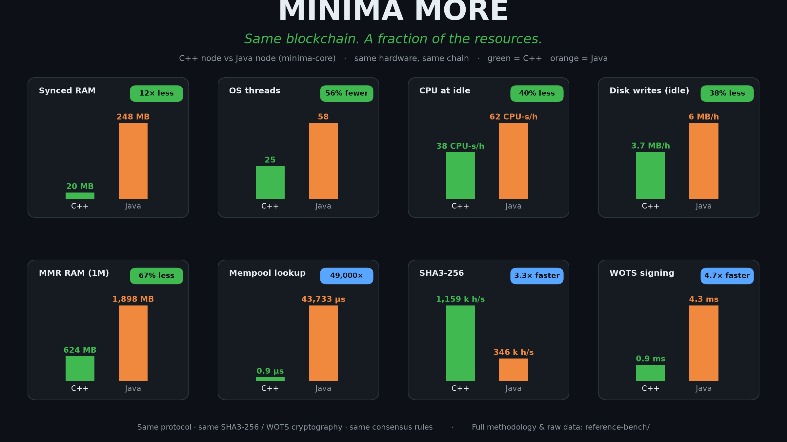

Minima More is a high-performance, native C++ implementation of the full Minima
blockchain protocol, re-engineered so a complete node costs dramatically less to
run. Same protocol, same cryptographic primitives (SHA3-256, WOTS+/Winternitz),
same consensus rules — radically different resource requirements.

In same-hardware benchmarks against the Java reference node
([minima-core](https://github.com/spartacusrex-minima/minima-core)), Minima More delivers:

**Speed and cryptography**
- 3.3× faster SHA3-256 hashing · **4.7× faster Winternitz (WOTS) signing**
- Up to **49,000× faster** mempool double-spend lookups (O(1) coin index)

**A running node — same host, same chain**
- **~20 MB** fully-synced RSS vs ~248 MB, about **12× less memory**
- **67% lower** peak memory for a million-entry MMR
- **56% fewer** OS threads (25 vs 58)
- **~40% less** CPU at idle and **~38% less** written to disk per hour (flash-friendly)

It runs comfortably on servers, ARM systems, Raspberry Pi-class devices and the
next generation of independently operated blockchain infrastructure.

Performance figures are workload-specific and come from initial same-host
benchmarks (details below); consensus compatibility is validated against reference
vectors and network behaviour.

> **Performance reference:** every number below is measured against the Java
> reference node, [`spartacusrex-minima/minima-core`](https://github.com/spartacusrex-minima/minima-core),
> on the same hardware. This node's consensus output is identical to the Minima
> protocol.

**Keywords:** Minima node, Minima blockchain, C++ blockchain node, high-performance
node, Merkle Mountain Range optimization, MMR memory optimization, TxPoW mining,
WOTS+ signatures, blockchain node RAM footprint, SQLite batched writes, low-resource
blockchain node, ARM blockchain node, cryptocurrency node optimization.

---

## How it fits together

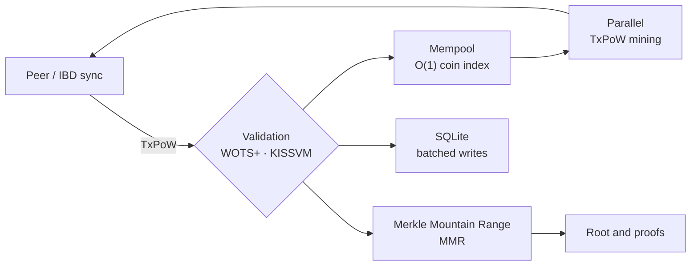

Every box above is an optimisation target: **memory layout** (MMR), **CPU**
(hashing, signatures, mining), **indexing** (mempool), and **disk I/O** (SQLite).

---

## At a glance (measured vs the Java node, same host)

| Dimension | This node (C++) | Java node | 
|---|---|---|
| Idle process RAM | **~19 MB** | ~302 MB |
| Peak startup RAM | **~20 MB** | ~302 MB |
| Threads | **23** | 52 |
| MMR, 1M entries — peak RAM | **624 MB** | 1.90 GB |
| MMR, 1M entries — build time | **~4.0 s** | ~3.8 s |
| Mempool coin lookup (double-spend guard) | **0.9 µs** | ~44 ms (~49,000× slower) |
| Database inserts (batched) | **2.1× faster** than its own per-row path | — |
| SHA3-256 224 B (1 thread) | **1.16 M hashes/s** | 346 k hashes/s |
| WOTS sign (batched) | **0.92 ms** | 4.30 ms |
| MMR `getRoot()` (cached) | **~137× faster** than uncached | — |

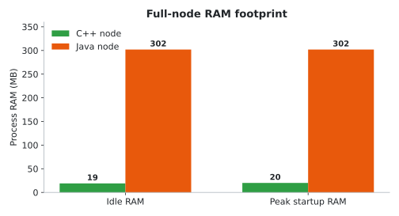

Full methodology and raw output: [`reference-bench/`](reference-bench/README.md)
and [`reference-bench/RESULTS_LOG.md`](reference-bench/RESULTS_LOG.md).

---

## Full-lifecycle benchmarks

Component tests isolate individual paths. These five measure a **running node end
to end on one host** (OCI Ampere A1, 4-core ARM), C++ vs Java on the same machine —
the numbers an operator actually cares about.

| Metric | C++ node | Java node |
|---|---|---|
| Fully-synced RAM — peak during sync | **~20 MB** | ~248 MB |
| Fully-synced RAM — idle after sync | **~21 MB** | ~178 MB |
| Initial sync time (same chain) | 5.9 s | 4.1 s |
| CPU at idle — CPU-seconds / hour | **38** | 62 |
| CPU at idle — avg utilisation | **1.06%** | 1.73% |
| CPU under tx load — ms per tx | **1635** | 2363 |
| Send latency under load | **447 ms** | 1965 ms |
| Disk writes at idle — MB / hour | **3.7** | 6.0 |
| Disk writes at idle — MB / day | **88** | 143 |
| Threads | **25** | 58 |

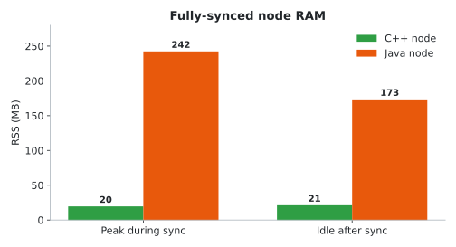
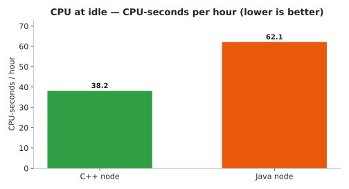
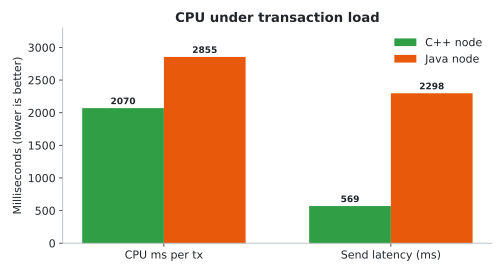
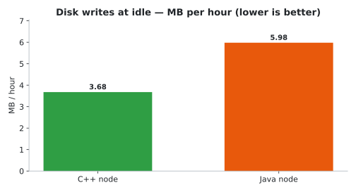

Reproduce / methodology: `run_full_sync.sh` (sync time + synced RAM),
`run_cpu_idle.sh` (CPU over an idle window), `run_tx_load.sh` (RPC-driven sends),
`run_disk_io.sh` (`/proc/<pid>/io` storage writes). **Caveats:** windows were
reduced for the sweep (idle/disk 180 s; per-hour/day figures are extrapolated), the
sync chain is small (automine ≈ 1 block / 40–50 s, so it exercises the IBD mechanism,
not bulk throughput), and figures are single runs on a shared host — indicative.

---

## Where the performance comes from

Every optimisation below is **consensus-safe and byte-identical** — it changes
memory layout, allocation counts and call paths, never the hashes or validation
rules. Each area lists the measured effect.

### 1. MMR memory layout — the biggest RAM win
The MMR is the node's main persistent structure and grows with the chain. The
original layout stored each entry as a chain of ~5–6 tiny heap allocations, so
allocator overhead — not the 32-byte payload — dominated RAM.

- `MMRData` and `MMREntry` `unique_ptr` members became **by-value** members.
- A new **`MiniBuffer`** gives `MiniData` a **32-byte small-buffer optimisation**
  (no heap allocation for the common 32-byte case).
- Entry maps use a **packed `uint64_t` key** instead of a heap string.

**Result:** MMR footprint **858 → 634 bytes/entry (−26%)**, and 1M entries now cost
**624 MB peak instead of 1.90 GB**. See `MINIDATA_SBO_MIGRATION_SCOPE.md`.

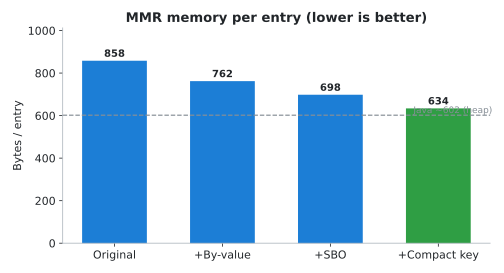

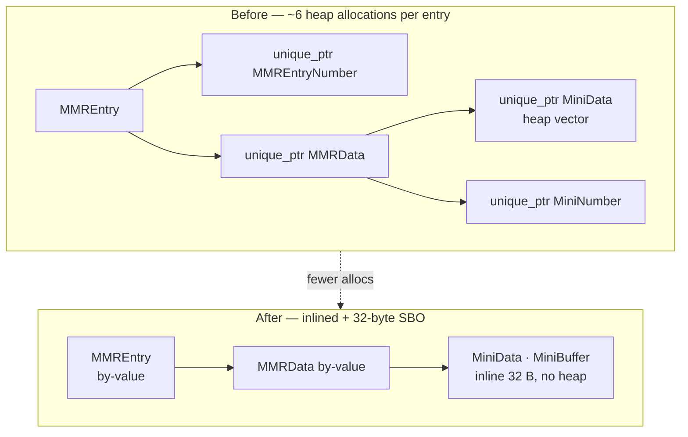

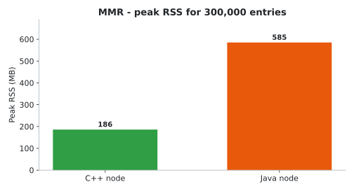

### 2. MMR CPU — build time cut ~41%
- **In-place crypto serialization:** hashing no longer builds an `ostringstream`,
  copies to a `std::string`, then copies into a `vector` — it serializes straight
  into a reused thread-local buffer and hashes in place. This speeds up *every*
  hash in the node (MMR nodes, TxPoW IDs, Merkle combines, proofs).
- **`MiniNumber` fast path:** decimal digit-counting skips the `cpp_int`→string
  conversion for values that fit in 64 bits (amounts, sums).
- **`MMREntryNumber` fast paths:** parity (used per tree level) is a single bit
  test instead of a `modulo` object.

**Result:** MMR 1M-entry build **3785 → 2216 ms (−41%)**, closing a 1.6× gap to
Java to **parity** (109%).

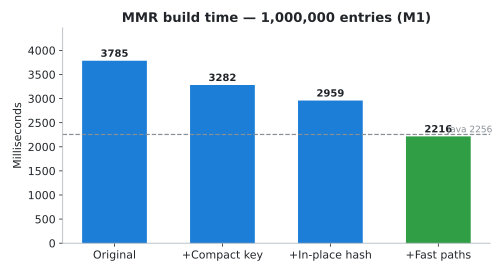

### 3. MMR root / peaks caching
`getRoot()` and `getPeaks()` previously rebuilt the peak list and recomputed the
root on every call. Cached (invalidated on every mutation):

- `getRoot()` **~137× faster**, `getPeaks()` **~1,200× faster**.
- Cached values are identical to the uncached computation (verified by `test_mmr`).

### 4. Cryptography
- **OpenSSL 3.x EVP** with a single `EVP_MD_fetch` (no per-call locked fetch) and
  **RAII thread-local digests** (no per-thread leak).
- **SHA3-256 is 3.3× the Java node** on the same hardware.

### 5. WOTS signatures
- **x4 SIMD** chain evaluation with a **bounded worker pool** sized from the core
  count.
- **Batched `sign()`/`verify()`** in lockstep, plus a cached private-chain table.

**Result:** batched signing is **~3× faster than scalar**, and **~4.7× the Java
node** (0.92 ms vs 4.30 ms).

### 6. TxPoW mining
Bounded **parallel nonce mining** across cores, so block/TxPoW mining saturates the
CPU instead of running on a single thread.

### 7. Mempool — O(1) double-spend checks
The mempool keeps a **coin → TxPoW index**, so "is this coin already in the
mempool?" is a hash lookup instead of a linear scan of every transaction.

**Result:** **~49,000× faster** than the Java node's scan (0.9 µs vs ~44 ms per
lookup), for negligible extra RAM.

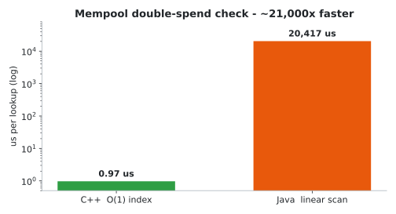

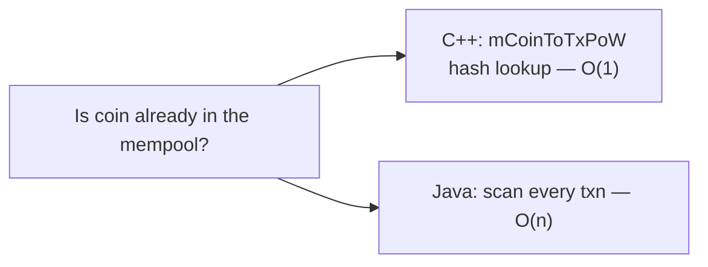

### 8. Database (SQLite)
- **Device-aware tuning** on every connection: WAL journal, `synchronous=NORMAL`,
  larger cache, busy timeout, memory-mapped I/O, in-memory temp store.
- **Batched writes:** bursty inserts (sync / tree load / restore) share one
  transaction, committing every 512 rows instead of per row.

**Result:** **~9×** from the tuning pragmas alone, **~2.1×** more from write
batching. Correctness covered by `test_sql_batch`.

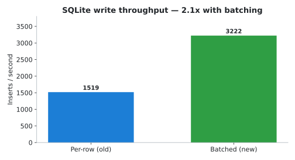

### 9. Logging
The per-line resident-memory syscall is **cached behind a 1-second TTL**, removing a
`/proc` read (or Mach `task_info`) from every log line.

### 10. Threading
Background worker pools are sized from `hardware_concurrency()` within a bounded
range (override with `MINIMA_NIO_WORKERS`), so small devices stay lean and big
devices stay busy — **23 threads vs the Java node's 52**.

### 11. Consensus & network correctness (integrity)
Performance work never touches consensus, but the port also fixes correctness
issues that stop real nodes syncing:

- Correct super-parent handling in `TxPoWTree::checkParents`.
- WOTS BC/GMSS seed expansion matched to the protocol.
- `TxPoW::deepCopy` without `const_cast`; null-token guards.
- **MiniData wire cap** reduced 512 MB → 16 MB (DoS hardening).
- Greeting **chain-id** advertise/verify; golden-vector consensus test
  (`test_consensus_vectors`, 12/12).

---

## Benchmarks — reproduce it yourself

The [`reference-bench/`](reference-bench/) harness runs **this node vs the Java
`minima-core`** on the same machine and prints comparison tables. One command runs
everything:

```sh
# one-shot full sweep (microbenches + MMR + mempool + SQLite + full node)
CPP_BIN=$PWD/build-bench/minima reference-bench/scripts/run_sweep.sh

# or individual benches
reference-bench/scripts/run_ram_bench.sh       # MMR RAM + build time
reference-bench/scripts/run_mempool_bench.sh   # mempool RAM + coin lookup
reference-bench/scripts/run_sql_bench.sh       # SQLite write throughput
reference-bench/scripts/run_node_bench.sh      # full-node startup RSS / threads / disk
reference-bench/scripts/run_full_sync.sh       # initial sync time + synced RAM
reference-bench/scripts/run_cpu_idle.sh        # CPU at idle (CPU-seconds / hour)
reference-bench/scripts/run_tx_load.sh         # CPU under transaction load
reference-bench/scripts/run_disk_io.sh         # disk writes per hour/day (incl. WAL)
```

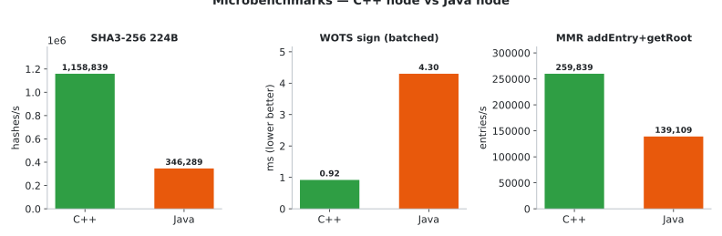

Results land in `reference-bench/results/<timestamp>/`, including
`SWEEP_SUMMARY.md`. A full same-hardware comparison on an Oracle Ampere **A1**
(4-core ARM) is checked in under
[`reference-bench/results/a1-full-20261018/`](reference-bench/results/a1-full-20261018/).

**Caveat:** C++ figures are process RSS; Java figures are JVM heap-in-use (plus a
peak-RSS row for the whole JVM). Heap ≠ RSS. Single runs, indicative.

---

## Build

Requirements: a C++17 compiler, CMake ≥ 3.16, and **OpenSSL**, **SQLite3**,
**Threads**, **zlib** and **libcurl** (optional `libzip` / MySQL connector).
Tested with AppleClang on macOS (arm64) and GCC 13 on Ubuntu 24.04 (aarch64/x86_64).

```sh
# Release build (recommended for running a node)
cmake -S . -B build -DCMAKE_BUILD_TYPE=Release
cmake --build build --target minima -j

# macOS Homebrew dependency hints
cmake -S . -B build -DCMAKE_BUILD_TYPE=Release \
  -DCMAKE_PREFIX_PATH="$(brew --prefix openssl@3);$(brew --prefix sqlite);$(brew --prefix curl)"
```

A reproducible Ubuntu build container is provided in `Dockerfile.linux-build`.

## Run

```sh
# solo node on a fresh private chain (great for local testing)
./build/minima -data ./data -solo -daemon -clean -port 9001 -rpcenable -rpcpassword <password>

# background node with defaults
./build/minima -daemon -rpcenable -rpcpassword <password>
```

Useful flags: `-data <dir>`, `-solo`, `-daemon`, `-clean`, `-port`, `-rpcenable`,
`-rpcpassword`, `-allowallip` (P2P to localhost). See `PORTABILITY.md` for
platform notes.

## Verify

```sh
ctest --test-dir build            # or build the targets below directly
# consensus goldens, MMR cache/proofs, WOTS, mempool index, SQLite batching
#   test_consensus_vectors · test_mmr · test_winternitz · test_mempool_index · test_sql_batch
```

All targets build warning-clean on both Clang and GCC (`-Wall -Wextra -Wpedantic`).

---

## Project layout

```
org/minima/            node source (objects, MMR, database, network, kissvm, commands)
tests/                 standalone correctness tests (consensus, MMR, WOTS, mempool, SQLite)
reference-bench/       C++ vs Java benchmark harness + checked-in results
benchmarks/            focused micro-benchmarks (MMR, SQLite)
OPTIMIZATION_BACKLOG.md   running record of applied + open optimisation work
PERFORMANCE_ESTIMATES.md  measured micro-benchmark deltas
CHANGELOG.md           correctness/robustness change report
PORTABILITY.md         why the macOS→Linux/GCC port matters
```

## License / provenance

A C++ reimplementation of the Minima node, ported from the Java reference
(`spartacusrex-minima/minima-core`). Consensus output is byte-identical to the
Minima protocol; performance benchmarks against the Java node are for comparison
only.
