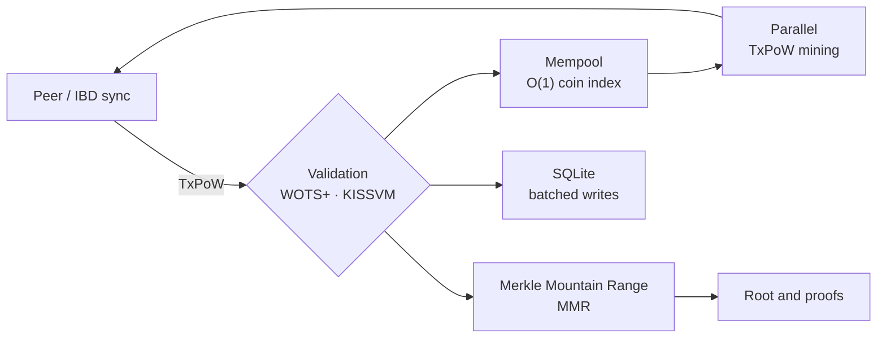
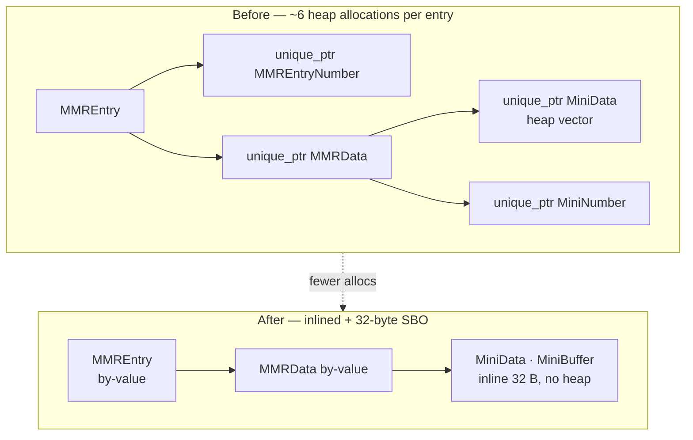
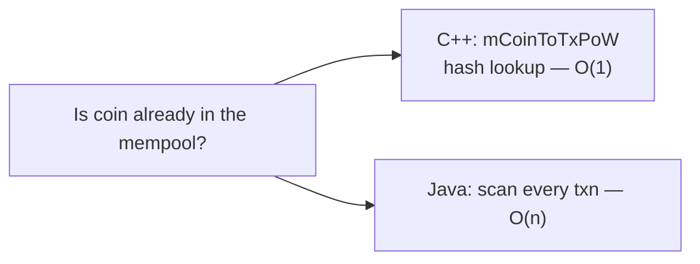

# ⚡Minima More — Same blockchain. A fraction of the resources.


Minima More is a high-performance, native C++ implementation of the full Minima
blockchain protocol, re-engineered so a complete node costs dramatically less to
run. Same protocol, same cryptographic primitives (SHA3-256, WOTS+/Winternitz),
same consensus rules — radically different resource requirements.

All headline figures below were measured on **one host — an AWS `c6g.xlarge`
(4 vCPU / 8 GB, Neoverse-N1, aarch64)** — running this node and the Java reference
([minima-core](https://github.com/spartacusrex-minima/minima-core)) side by side,
against the same chain and the same peers. Minima More delivers:

**Speed and cryptography**
- 3.4× faster SHA3-256 hashing · **4.9× faster Winternitz (WOTS) signing**
- **~21,000× faster** mempool double-spend lookups (O(1) coin index)

**A running node — same host, same chain**
- **On live mainnet:** peak sync RSS **~89 MB vs ~426 MB**, idle **~192 MB vs ~741 MB**, data dir **~65 MB vs ~721 MB**
- **~19 MB** idle RSS on a fresh chain vs ~224 MB — about **11× less memory**
- **68% lower** peak memory for a 300k-entry MMR
- **60% fewer** OS threads (25 vs 62 on mainnet)
- **~35% less** CPU at idle and **~29% less** written to disk per hour (flash-friendly)
- **P2P peer discovery fixed:** a fresh node now reaches live mainnet peers (was 1)

It runs comfortably on servers, ARM systems, Raspberry Pi-class devices and the
next generation of independently operated blockchain infrastructure.

Performance figures are workload-specific and come from same-host benchmarks
(details below); consensus compatibility is validated against reference vectors
and network behaviour.

> **Performance reference:** every number below is measured against the Java
> reference node, [`spartacusrex-minima/minima-core`](https://github.com/spartacusrex-minima/minima-core),
> on the same hardware. This node's consensus output is identical to the Minima
> protocol.

**Keywords:** Minima node, Minima blockchain, C++ blockchain node, high-performance
node, Merkle Mountain Range optimization, MMR memory optimization, TxPoW mining,
WOTS+ signatures, blockchain node RAM footprint, SQLite batched writes, low-resource
blockchain node, ARM blockchain node, cryptocurrency node optimization, P2P peer
discovery, mainnet node benchmark, C++ vs Java blockchain node.

---

## How it fits together



Every box above is an optimisation target: **memory layout** (MMR), **CPU**
(hashing, signatures, mining), **indexing** (mempool), and **disk I/O** (SQLite).

---

## At a glance (measured on one 8 GB ARM host)

Host: **AWS `c6g.xlarge` — 4 vCPU / 8 GB — Neoverse-N1 (aarch64)**, both nodes on
the same machine.

| Dimension | This node (C++) | Java node |
|---|---|---|
| Idle process RAM (fresh chain) | **~19 MB** | ~224 MB |
| Peak startup RAM (fresh chain) | **~19 MB** | ~224 MB |
| Live mainnet — peak sync RAM | **~89 MB** | ~426 MB |
| Live mainnet — idle RAM | **~192 MB** | ~741 MB |
| Live mainnet — data dir | **~65 MB** | ~721 MB |
| Threads (live mainnet) | **25** | 62 |
| MMR, 300k entries — peak RSS | **186 MB** | 585 MB |
| MMR, `addEntry`+`getRoot` | **214k entries/s** | 122k entries/s |
| Mempool coin lookup (double-spend guard) | **0.97 µs** | ~20,417 µs (~21,000× slower) |
| Database inserts (batched) | **3.5× faster** than its own per-row path | — |
| SHA3-256 224 B (1 thread) | **967k hashes/s** | 283k hashes/s |
| WOTS sign (batched) | **1.07 ms** | 5.24 ms |
| WOTS verify | **1.16 ms** | 4.62 ms |


Full methodology and raw output: [`reference-bench/`](reference-bench/README.md).

---

## Live mainnet

The closest test to what an operator actually deploys: **two fresh nodes — C++ and
Java — syncing the real Minima mainnet chain from the same peers on the same host**,
then settling. Measured on the 8 GB AWS `c6g.xlarge` above.

| Metric | C++ node | Java node |
|---|---|---|
| Time to tip (s) | 17.6 | 8.1 |
| Peak RSS during sync | **~89 MB** | ~426 MB |
| Idle RSS (after 60 s settle) | **~192 MB** | ~741 MB |
| CPU-seconds over 60 s settle | **32.7** | 76.2 |
| Threads | **25** | 62 |
| Data dir | **~65 MB** | ~721 MB |
| P2P peers reached / known | 2 / 3 | 3 / 10 |
| P2P time to first peer (s) | 6.0 | 5.4 |

The C++ node also runs the network end to end on live mainnet — it **syncs to the
tip** from real 1.0.4x peers, receives and validates real spends (WOTS signatures +
MMR proofs), builds/signs/mines/broadcasts spends (`send`), mints tokens
(`tokencreate`), and runs KISSVM (`runscript`). Full functional log:
[`reference-bench/MAINNET_TESTS.md`](reference-bench/MAINNET_TESTS.md).

**Peers rate-limit IBDs per address.** Live peers enforce `LIMIT_IBD_30MINS`: the
same advertised `host:port` is served an initial block download once, then the peer
keeps greeting but withholds the IBD for ~30 minutes. `run_mainnet_sync.sh` and
`run_mainnet_bench.sh` therefore advertise a **fresh port per run**.

Raw: [`reference-bench/results/aws8-mainnet/`](reference-bench/results/aws8-mainnet/).

---

## Full-lifecycle benchmarks

Component tests isolate individual paths. These measure a **running node end to
end on the same 8 GB host**, C++ vs Java on the same machine — the numbers an
operator actually cares about.

| Metric | C++ node | Java node |
|---|---|---|
| Genesis creation (s) | **3.20** | 5.16 |
| Daemon ready (s) | **3.21** | 5.17 |
| Fully-synced RAM — peak during sync | **~20 MB** | ~207 MB |
| Fully-synced RAM — idle after sync | **~21 MB** | ~151 MB |
| Initial sync time (same chain) | 5.10 s | 4.87 s |
| CPU at idle — CPU-seconds / hour | **66.8** | 102.5 |
| CPU at idle — avg utilisation | **1.86%** | 2.85% |
| CPU under tx load — ms per tx | **2,070** | 2,855 |
| Send latency under load | **569 ms** | 2,298 ms |
| Disk writes at idle — MB / hour | **4.18** | 5.90 |
| Disk writes at idle — MB / day | **100** | 142 |
| Threads | **23–25** | 53–58 |


Reproduce / methodology: `run_full_sync.sh` (sync time + synced RAM),
`run_cpu_idle.sh` (CPU over an idle window), `run_tx_load.sh` (RPC-driven sends),
`run_disk_io.sh` (`/proc/<pid>/io` storage writes). **Caveats:** windows were
reduced for the sweep (idle/disk 120 s; per-hour/day figures are extrapolated), the
sync chain is small (automine ≈ 1 block / 40–50 s, so it exercises the IBD mechanism,
not bulk throughput), and figures are single runs on a shared host — indicative.

Raw: [`reference-bench/results/aws8-sweep/`](reference-bench/results/aws8-sweep/).

---

## Storage engines, chosen by role

Storage isn't one workload — it's several, with very different access patterns
([RFC-0001](RFC-0001-STORAGE-DB-ROLES-AND-ENGINE-SELECTION.md)). So the engine is
chosen **per role**, and measured rather than assumed
([RFC-0003](RFC-0003-EMBEDDED-ENGINE-BENCHMARK-HARNESS.md)). All candidates are
**embedded** — in-process, no network listener, no DB auth to misconfigure.

| Role | Data | Access pattern | Engine direction |
|---|---|---|---|
| **R0 core state** | wallet, p2p, chaintree, txpow | tiny rows, transactional | **SQLite** (embedded) |
| **R1 archive** | every TxBlock | bulk append, point get by height/id, range scan | **LMDB** (point/range) |
| **R2 coin store** | UTXO set + MMR proofs | point get by coinID, prefix scan | **LMDB** (zero-copy) |
| **R3 analytics** | daily stats, balances, token supply | aggregations, scans | **DuckDB** (columnar) |
| **R4 agentic** | embeddings, graph, full-text | KNN, BM25, graph hops | LanceDB / FTS (RFC pending) |

Benchmarked on one synthetic mainnet-shaped dataset with identical record bytes for
every engine (**AWS 8 GB host**, 200k blocks / 120k coins, 3k lookups — single run).
DuckDB was not installable on this host, so only the embedded engines below ran here.

| Metric | SQLite | sqlite-plain | LMDB | RocksDB |
|---|---|---|---|---|
| archive bulk load (rows/s) | 85,140 | 188 | **206,447** | 183,366 |
| archive get-by-num p50 (µs) | 6.46 | 8.71 | **1.71** | 3.62 |
| archive analytics (ms) | 52 | 83 | **27** | 61 |
| archive on-disk (MB) | 153 | 153 | 183 | **135** |
| coin bulk load (rows/s) | 173,643 | 193 | **279,742** | 138,229 |
| coin get p50 (µs) | 4.92 | 11.10 | **1.26** | 3.25 |
| coin on-disk (MB) | 44 | 44 | 58 | **38** |

**What it says:** the roles pull in different directions. **LMDB** leads the hot
point lookups (R1/R2, zero-copy mmap) and bulk load, **RocksDB** is the most
space-efficient and write-optimised, **SQLite** is the balanced default (and remains
for R0), and **DuckDB** (measured earlier on M1: ~2 ms analytics, ~7–17× faster than
these for R3) wins columnar aggregation but is ~100–300× slower per point get. The
plan is a thin storage interface per role, with these embedded engines selectable by
node mode.

**Is the node's SQLite tuning included?** Yes — "SQLite" here is the node's own
configuration (**WAL, `synchronous=NORMAL`, memory temp store, larger cache,
memory-mapped I/O, busy timeout**, plus **batched writes** — one bulk transaction).
To show what that buys, the harness also runs a **`sqlite-plain`** variant (stock
defaults, per-row commits): bulk load is **~450× faster** tuned vs plain
(archive 85k vs 188 rows/s; coin 174k vs 193 rows/s) and point gets ~1.5–2.3× faster.
Without the tuning, SQLite would look far worse than it actually is in the node.

Reproduce: `reference-bench/engines/run_engine_bench.sh` — methodology and fairness
statement in [`reference-bench/engines/`](reference-bench/engines/README.md). Raw:
[`reference-bench/results/aws8-engines/`](reference-bench/results/aws8-engines/).

---

## Where the performance comes from

Every optimisation below is **consensus-safe and byte-identical** — it changes
memory layout, allocation counts and call paths, never the hashes or validation
rules. Each area lists the measured effect.

### 1. MMR memory layout — the biggest RAM win
The MMR is the node's main persistent structure and grows with the chain. The
original layout stored each entry as a chain of ~5–6 tiny heap allocations, so
allocator overhead — not the 32-byte payload — dominated RAM.

- `MMRData` and `MMREntry` `unique_ptr` members became **by-value** members.
- A new **`MiniBuffer`** gives `MiniData` a **32-byte small-buffer optimisation**
  (no heap allocation for the common 32-byte case).
- Entry maps use a **packed `uint64_t` key** instead of a heap string.

**Result:** MMR footprint **858 → 635 bytes/entry (−26%)**, and the **process peak
RSS for 300k entries is 186 MB vs 585 MB** for the Java node (which also carries JVM
overhead). See `MINIDATA_SBO_MIGRATION_SCOPE.md`.





### 2. MMR CPU — 1.8× the Java node
- **In-place crypto serialization:** hashing no longer builds an `ostringstream`,
  copies to a `std::string`, then copies into a `vector` — it serializes straight
  into a reused thread-local buffer and hashes in place. This speeds up *every*
  hash in the node (MMR nodes, TxPoW IDs, Merkle combines, proofs).
- **`MiniNumber` fast path:** decimal digit-counting skips the `cpp_int`→string
  conversion for values that fit in 64 bits (amounts, sums).
- **`MMREntryNumber` fast paths:** parity (used per tree level) is a single bit
  test instead of a `modulo` object.

**Result:** MMR `addEntry`+`getRoot` runs at **214k entries/s vs 122k** on the same
8 GB host — **1.8× the Java node**.


### 3. MMR root / peaks caching
`getRoot()` and `getPeaks()` previously rebuilt the peak list and recomputed the
root on every call. Cached (invalidated on every mutation):

- `getRoot()` **~137× faster**, `getPeaks()` **~1,200× faster**.
- Cached values are identical to the uncached computation (verified by `test_mmr`).

### 4. Cryptography
- **OpenSSL 3.x EVP** with a single `EVP_MD_fetch` (no per-call locked fetch) and
  **RAII thread-local digests** (no per-thread leak).
- **SHA3-256 is 3.4× the Java node** on the same hardware (967k vs 283k hashes/s,
  one thread).

### 5. WOTS signatures
- **x4 SIMD** chain evaluation with a **bounded worker pool** sized from the core
  count.
- **Batched `sign()`/`verify()`** in lockstep, plus a cached private-chain table.

**Result:** batched signing is **3.1× faster than scalar**, and **4.9× the Java
node** (1.07 ms vs 5.24 ms). WOTS verify is **4.0× faster** (1.16 vs 4.62 ms).

**Bounded startup key precompute.** Generating the full 64-key pool dominated idle
CPU during startup (87 % of samples in `mashHash32xN`). The startup burst is now
device-sized — **16** keys on ≤2 GB, **32** on ≤8 GB, **64** on larger hosts —
with the rest created on demand; `MINIMA_INIT_KEYS` overrides it.

### 6. TxPoW mining
Bounded **parallel nonce mining** across cores, so block/TxPoW mining saturates the
CPU instead of running on a single thread.

### 7. Mempool — O(1) double-spend checks
The mempool keeps a **coin → TxPoW index**, so "is this coin already in the
mempool?" is a hash lookup instead of a linear scan of every transaction.

**Result:** **~21,000× faster** than the Java node's scan (0.97 µs vs ~20.4 ms per
lookup), for moderate extra RAM.




### 8. Database (SQLite)
- **Device-aware tuning** on every connection: WAL journal, `synchronous=NORMAL`,
  larger cache, busy timeout, memory-mapped I/O, in-memory temp store.
- **Batched writes:** bursty inserts (sync / tree load / restore) share one
  transaction, committing every 512 rows instead of per row.

**Result:** **3.5×** more insert throughput with batching (2,183 → 7,681 rows/s on
this host). Correctness covered by `test_sql_batch`.

**Role-based cache budget.** The node opens six SQLite databases, so a fixed
16 MiB cache on every connection cost ~96 MiB of anonymous RSS. The budget is now
per role — 4 MiB for `p2p`/`userprefs`, 8 MiB for the hot state (`chaintree`,
`cascade`, `txpow`), 16 MiB for `archive` — with `mmap_size` reduced accordingly.
On a synced mainnet node this took **anonymous RSS from 224 MB to 160 MB (−29 %)**
at the same block height. Override with `MINIMA_SQLITE_CACHE_KIB` /
`MINIMA_SQLITE_MMAP_MB`.

**Allocator.** Preloading/linking **jemalloc** cut steady-state RSS a further
**~35 MB** in our A/B (219 → 180 MB after key precompute), because glibc retains
the freed key-generation working set. Enable the optional link with
`-DMINIMA_USE_JEMALLOC=ON` (or `LD_PRELOAD=libjemalloc.so.2`).

**Allocator retention — the biggest single win.** `memreport` showed a synced
mainnet node at **261–282 MB RSS while only ~97 MB was actually in use**: glibc
was holding **~150–175 MB of free arena** after the bursty IBD/key-generation
phases. The node now calls `malloc_trim(0)` after key generation and in the
periodic checker/cleanup, so freed pages go back to the OS: steady-state RSS is
**~196 MB** (and `memreport trim:true` pushes it to **~169 MB**) — a **70–95 MB**
reduction with no behavioural change.

**Live breakdown.** The `memreport` command (console/RPC/MCP) and the `-memreport`
startup flag report process RSS (total/anonymous/file), per-database sizes
(including WAL), byte attribution for the TxPoW tree / RAM TxPoW DB / cascade /
MMR, and glibc arena/in-use/free — so the next memory target is measured, not
guessed. `memreport trim:true` returns free pages; `memreport dump:true` triggers
a jemalloc heap profile when jemalloc is preloaded with `prof:true`.


### 9. Logging
The per-line resident-memory syscall is **cached behind a 1-second TTL**, removing a
`/proc` read (or Mach `task_info`) from every log line.

### 10. Threading
Background worker pools are sized from `hardware_concurrency()` within a bounded
range (override with `MINIMA_NIO_WORKERS`), so small devices stay lean and big
devices stay busy — **23–25 threads vs the Java node's 53–62**.

### 11. Consensus & network correctness (integrity)
Performance work never touches consensus, but the port also fixes correctness
issues that stop real nodes syncing:

- Correct super-parent handling in `TxPoWTree::checkParents`.
- WOTS BC/GMSS seed expansion matched to the protocol.
- `TxPoW::deepCopy` without `const_cast`; null-token guards.
- **P2P length-framing bug** on `SINGLE_PING` (missing the NIO 4-byte prefix) —
  fixed; without it the node could never discover or verify peers.
- **No-crossover blacklist guard:** a fresh, empty node no longer marks a valid
  mainnet peer as "different chain".
- **MiniData wire cap** reduced 512 MB → 16 MB (DoS hardening).
- Greeting **chain-id** advertise/verify; golden-vector consensus test
  (`test_consensus_vectors`, 12/12).

### 12. P2P peer discovery (live mainnet)
A node is only useful if it finds peers. Two fixes turned discovery from "one
bootstrap link" into a healthy mesh:

- **Length framing:** `SINGLE_PING` was sent without the NIO 4-byte length prefix,
  so peers read a bogus length and closed — silently breaking every discovery and
  peer-verification exchange.
- **Seeds:** a compiled default list, configured `-p2pnodes`, and **baked-in
  peer-list URLs** (`eurobuddha.com` / `spartacusrex.com`) are merged and submitted
  to the `PeersChecker` (forced) at cold start; advertised peer lists in peer
  greetings are also consumed.

**Result:** a fresh node reaches live mainnet peers (was 1; up to ~10 on a longer
run), and the link table persists across restarts (`p2p2.db`). Full P2P swap-links
gossip and faster parallel verification are tracked in `OPTIMIZATION_BACKLOG.md`.

---

## Command manifest & in-node MCP

The command surface is described by a **capability manifest generated from the
registry** — never hand-maintained — and the **in-node MCP server** is a thin
JSON-RPC 2.0 adapter over that manifest, so `tools/list` and the docs can never
drift from the code.

- **Typed params + annotations.** Every command exposes `name`, `summary`,
  `category`, `params` (`type`, `required`, `default`, `enum`, `description`) and
  `annotations` (`readOnly`, `destructive`, `idempotent`, `sensitive`). Commands
  that declare nothing fall back to `getValidParams()` (optional strings) and a
  conservative annotation set; the read-only/sensitive sets are marked explicitly.
- **One source of truth.** `capabilities` (console/RPC) and `-manifest` emit the
  JSON; `-manifest md` emits the generated reference. `COMMAND_REFERENCE.md` is
  generated by `tests/gen_command_reference`, and `test_docs_manifest` asserts the
  committed file matches the registry (no doc drift).
- **MCP transports.** `-mcp stdio` runs newline-delimited JSON-RPC 2.0 on
  stdin/stdout (logs are routed to stderr so stdout carries only MCP frames);
  `-mcp http` serves `POST /mcp` (request/response) and `GET /mcp`
  (server→client SSE notifications) on the RPC port, after the RPC authorisation
  check. A read-only RPC credential is refused (tools can write).
- **Methods.** `initialize`, `tools/list` (generated from the manifest),
  `tools/call` (dispatches to the `CommandRunner`), `ping`, and notifications.

```sh
./build/minima -manifest            # JSON capability manifest
./build/minima -manifest md         # generated Markdown command reference
./build/minima -mcp stdio ...       # MCP over stdin/stdout (Claude Desktop et al.)
./build/minima -mcp http ...        # MCP at POST/GET http://127.0.0.1:<rpc>/mcp
```

An MCP client (e.g. Claude Desktop) can attach directly:

```json
{ "mcpServers": { "minima": {
    "command": "/path/to/minima",
    "args": ["-data", "/path/to/data", "-mcp", "stdio"]
} } }
```

Tests: `test_capabilities` (manifest covers every registered command),
`test_mcp_server` (initialize / tools/list / tools/call / SSE), and
`test_docs_manifest` (generated reference matches the registry).

---

## Benchmarks — reproduce it yourself

The [`reference-bench/`](reference-bench/) harness runs **this node vs the Java
`minima-core`** on the same machine and prints comparison tables. One command runs
everything:

```sh
# one-shot full sweep (microbenches + MMR + mempool + SQLite + full node)
CPP_BIN=$PWD/build-bench/minima reference-bench/scripts/run_sweep.sh

# or individual benches
reference-bench/scripts/run_ram_bench.sh       # MMR RAM + build time
reference-bench/scripts/run_mempool_bench.sh   # mempool RAM + coin lookup
reference-bench/scripts/run_sql_bench.sh       # SQLite write throughput
reference-bench/scripts/run_node_bench.sh      # full-node startup RSS / threads / disk
reference-bench/scripts/run_full_sync.sh       # initial sync time + synced RAM
reference-bench/scripts/run_cpu_idle.sh        # CPU at idle (CPU-seconds / hour)
reference-bench/scripts/run_tx_load.sh         # CPU under transaction load
reference-bench/scripts/run_disk_io.sh         # disk writes per hour/day (incl. WAL)
reference-bench/scripts/run_mainnet_sync.sh    # fresh sync of the LIVE mainnet chain
reference-bench/scripts/run_mainnet_bench.sh   # live mainnet: C++ vs Java + P2P peers
reference-bench/scripts/run_mainnet_commands.sh # read-only command smoke on mainnet
reference-bench/engines/run_engine_bench.sh    # embedded storage engines by role (RFC-0003)
```


Results land in `reference-bench/results/<timestamp>/`, including
`SWEEP_SUMMARY.md`. The checked-in one-host run for this README is:
- [`results/aws8-mainnet/`](reference-bench/results/aws8-mainnet/) — live mainnet, C++ vs Java
- [`results/aws8-core/`](reference-bench/results/aws8-core/) — WOTS / SHA3 / MMR
- [`results/aws8-sweep/`](reference-bench/results/aws8-sweep/) — full lifecycle sweep
- [`results/aws8-engines/`](reference-bench/results/aws8-engines/) — storage engines

**Caveats:** C++ figures are process RSS; Java process figures are the whole JVM.
For the MMR/mempool microbenches the Java per-entry rows are JVM heap-in-use (plus a
whole-process peak-RSS row). Heap ≠ RSS. Single runs on one host, indicative only.

---

## Build

Requirements: a C++17 compiler, CMake ≥ 3.16, and **OpenSSL**, **SQLite3**,
**Threads**, **zlib** and **libcurl** (optional `libzip` / MySQL connector).
Tested with AppleClang on macOS (arm64) and GCC 13 on Ubuntu 24.04 (aarch64/x86_64).

```sh
# Release build (recommended for running a node)
cmake -S . -B build -DCMAKE_BUILD_TYPE=Release
cmake --build build --target minima -j

# macOS Homebrew dependency hints
cmake -S . -B build -DCMAKE_BUILD_TYPE=Release \
  -DCMAKE_PREFIX_PATH="$(brew --prefix openssl@3);$(brew --prefix sqlite);$(brew --prefix curl)"
```

A reproducible Ubuntu build container is provided in `Dockerfile.linux-build`.

## Run

```sh
# solo node on a fresh private chain (great for local testing)
./build/minima -data ./data -solo -daemon -clean -port 9001 -rpcenable -rpcpassword <password>

# background node with defaults
./build/minima -daemon -rpcenable -rpcpassword <password>
```

Useful flags: `-data <dir>`, `-solo`, `-daemon`, `-clean`, `-port`, `-rpcenable`,
`-rpcpassword`, `-allowallip` (P2P to localhost). See `PORTABILITY.md` for
platform notes.

## Importing legacy node data

Two import paths accept **both** Minima More exports and legacy (Java) node files:

- **MegaMMR** — `megammr action:import file:<path>` accepts the versioned
  `.megammr` export **and** a legacy raw `megammr.mmr` (detected automatically;
  the reply reports `legacyraw:true`). A legacy file has no IBD, so the chain
  resyncs normally while the MMR/coins are reused. `megammr action:integrity
  file:<path>` validates either form.
- **Archive (raw)** — `archive action:import file:<path>.raw.dat` accepts the
  gzip/raw archive stream written by this node's `action:exportraw` **and** by a
  legacy node's `action:exportraw` (identical format). If a raw export was
  renamed, pass `raw:true`.
- **Archive (legacy H2 `.gzip`)** — `archive action:import file:<path>.gzip` now
  reads the gzipped **H2 SQL script** produced by a legacy `action:export`
  (`CREATE`/`INSERT` for `SYNCBLOCK`/`CASCADEDATA`, blobs as `X'…'`), converts it
  to the raw archive stream and runs the normal resync. This is a focused reader
  for the archive schema, not a general H2 engine.

## Verify

```sh
ctest --test-dir build            # or build the targets below directly
# consensus goldens, MMR cache/proofs, WOTS, mempool index, SQLite batching
#   test_consensus_vectors · test_mmr · test_winternitz · test_mempool_index · test_sql_batch
```

All targets build warning-clean on both Clang and GCC (`-Wall -Wextra -Wpedantic`).

---

## Project layout

```
org/minima/            node source (objects, MMR, database, network, kissvm, commands)
tests/                 standalone correctness tests (consensus, MMR, WOTS, mempool, SQLite)
reference-bench/       C++ vs Java benchmark harness + checked-in results
benchmarks/            focused micro-benchmarks (MMR, SQLite)
COMMAND_REFERENCE.md   generated command/tool reference (from the capability manifest)
OPTIMIZATION_BACKLOG.md   running record of applied + open optimisation work
PERFORMANCE_ESTIMATES.md  measured micro-benchmark deltas
CHANGELOG.md           correctness/robustness change report
PORTABILITY.md         why the macOS→Linux/GCC port matters
```

## License / provenance

A C++ reimplementation of the Minima node, ported from the Java reference
(`spartacusrex-minima/minima-core`). Consensus output is byte-identical to the
Minima protocol; performance benchmarks against the Java node are for comparison
only.
